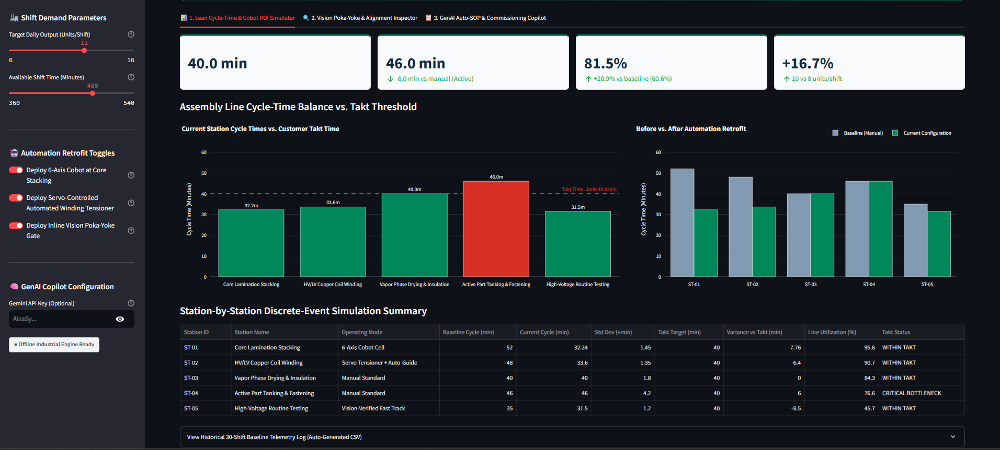
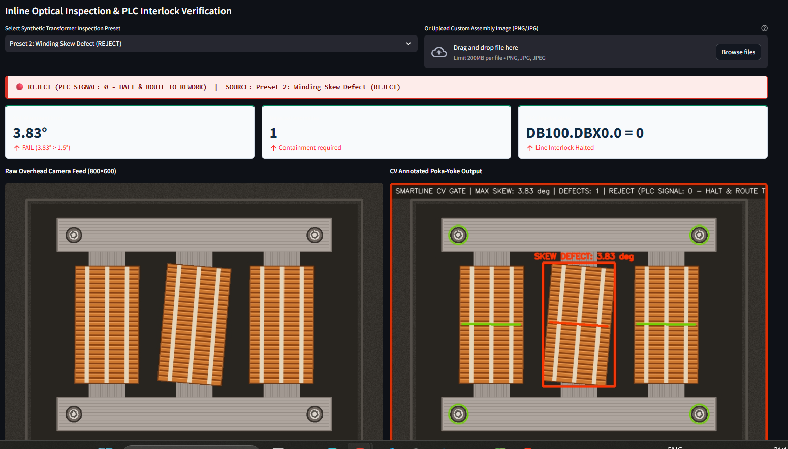
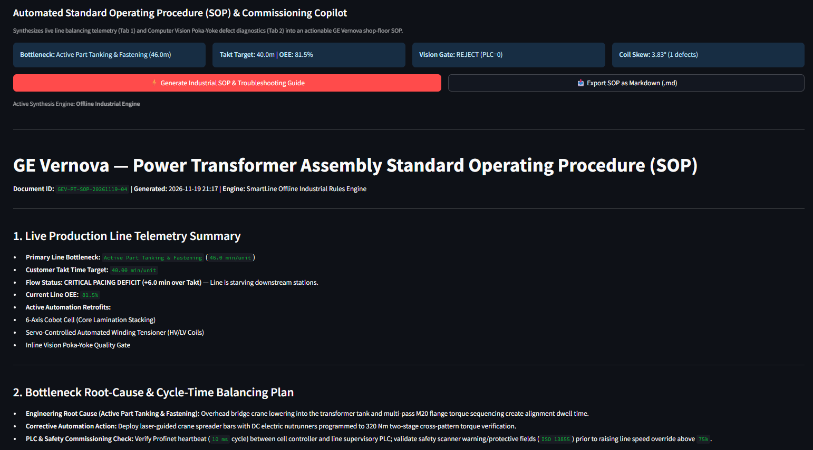

# ⚡ SmartLine: Transformer Assembly Line Simulator, Vision Inspector & SOP Generator

[](https://smartline-grid-automation.streamlit.app/)


**👉 Live demo: https://smartline-grid-automation.streamlit.app/** (no install, no API key needed)

---

## 🎥 End-to-End Video Walkthrough

https://github.com/user-attachments/assets/d025546a-8eb8-4d86-b525-0ed8839c49e1

---

## What is this?
A proof-of-concept tool that shows how **lean manufacturing, automation, and computer vision** can work together on a **power transformer assembly line**. It simulates a 5-stage line, finds the bottleneck, tests the effect of adding automation, inspects assembly images for defects, and auto-generates a shop-floor SOP.

> Built as a learning/portfolio project to practice process analysis and automation concepts. All data is **synthetic** (see Limitations).

## Why it matters
In transformer manufacturing, one slow station (e.g., manual core stacking) sets the pace for the whole line, and a small winding misalignment found late costs a full rework cycle at HV testing. SmartLine demonstrates how to:
1. **Find** the bottleneck against Takt Time.
2. **Test** "what if we add a cobot / servo winder?" before spending money.
3. **Catch** alignment and surface defects early with a Poka-Yoke vision gate.
4. **Document** the fix as an SOP automatically.

## Three modules

| Module | Tech | What it does |
|---|---|---|
| **1. Line Balancing & Cobot ROI** | SimPy, Pandas, Plotly | Simulates 5 stations (Core Stacking → Coil Winding → Vapor Phase Drying → Tanking → HV Testing). Calculates Takt Time, bottleneck, OEE. Toggle automation and compare before vs. after. |
| **2. Vision Poka-Yoke Gate** | OpenCV (Canny, Hough, contours) | Measures winding alignment angle (±1.5° tolerance), detects surface scratches and missing fasteners, outputs PASS / REJECT. Works on built-in samples or your own upload. |
| **3. SOP & Troubleshooting Copilot** | Gemini 2.5 Flash + offline rules engine | Takes the bottleneck and defect findings from Modules 1 and 2 and generates a downloadable SOP with process steps, quality checkpoints, and a troubleshooting table. Works fully offline without an API key. |

## Screenshots

### 1. Lean Cycle-Time & Cobot ROI Simulator
Models a 5-stage serial power transformer assembly line (*Core Lamination Stacking → HV/LV Copper Coil Winding → Vapor Phase Drying → Active Part Tanking → High-Voltage Routine Testing*). Toggling automation retrofits dynamically recalculates station cycle variance, shifts the primary bottleneck, and boosts Line OEE from **60.6% → 81.5%** (+16.7% throughput gain).



---

### 2. Vision Poka-Yoke & Alignment Inspector
Runs an explainable, deterministic computer vision pipeline on overhead assembly feeds (or custom uploaded images) without requiring GPU inference:
- **Winding Alignment Metrology:** Extracts conductor turn angles via Canny edge detection and Probabilistic Hough Line Transforms (`±1.50°` engineering tolerance).
- **Surface & Fastener Inspection:** Detects interlaminar silicon-steel core scratches and missing M20 corner clamping bolts.
- **Automated PLC Interlock:** Outputs `DB100.DBX0.0 = 1` (**PASS — Advance Conveyor**) or `DB100.DBX0.0 = 0` (**REJECT — Halt & Route to Rework**).



---

### 3. GenAI Auto-SOP & Commissioning Copilot
Pulls live telemetry directly from Tabs 1 and 2 to generate structured, audit-ready Standard Operating Procedures (SOPs) complete with root-cause cycle balancing actions, Lockout/Tagout (LOTO) safety protocols, and downloadable Markdown reports. Includes a built-in deterministic industrial rules engine so it runs 100% offline with zero API keys required.



---
## Key formulas
- **Takt Time** = Available shift time ÷ Target daily output
- **OEE** = Availability × Performance × Quality

## Example result
With default assumptions, deploying a cobot at core stacking plus an automated winding tensioner moves the bottleneck and raises simulated line OEE from **60.6% to 81.5%**. These figures depend on the assumed cycle times in `src/data_generator.py`; change them in the sidebar to test other scenarios.

## Run locally
```bash
git clone https://github.com/Riyasharma-17/SmartLine.git
cd SmartLine
python -m venv .venv
source .venv/bin/activate        # Windows: .venv\Scripts\activate
pip install -r requirements.txt
streamlit run app.py
```
Optional: paste a free Gemini API key in Tab 3 for AI-written SOPs. Otherwise use the offline engine.

## Project structure
```text
SmartLine/
├── app.py                  # Streamlit dashboard (3 tabs)
├── requirements.txt
├── assets/                 # Screenshots
└── src/
    ├── data_generator.py   # Synthetic cycle-time logs + inspection images
    ├── simulation.py       # SimPy engine, Takt Time, OEE
    ├── vision_inspector.py # Canny/Hough alignment + defect detection
    └── sop_copilot.py      # Gemini SOP generator + offline fallback
```

## Limitations (honest scope)
- Cycle times, sensor logs, and inspection images are **synthetically generated**, not from a real plant.
- Vision uses classical OpenCV on synthetic images. It is not validated on real factory imagery, lighting, or camera setups.
- The PLC output (`DB100.DBX0.0`) is an illustrative signal, not connected to real hardware.
- OEE and throughput gains are simulation outputs based on assumptions, not measured results.

## What I'd do next
- Calibrate the simulation with real time-study data.
- Test the vision pipeline on real images and add a trained detector (e.g., YOLOv8).
- Add cost and payback-period calculations for automation ROI.
- Integrate with OPC-UA/PLC for live signals.

## What I learned
Line balancing and Takt Time analysis, discrete-event simulation with SimPy, classical computer vision for metrology, and turning technical findings into SOP documentation.

**Author:** Riya | B.Tech CCE, Amrita Vishwa Vidyapeetham, Amaravati